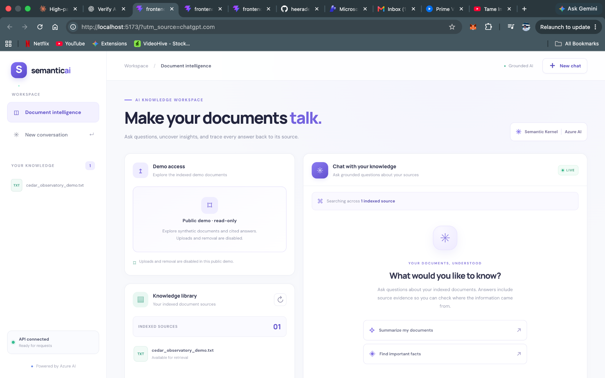
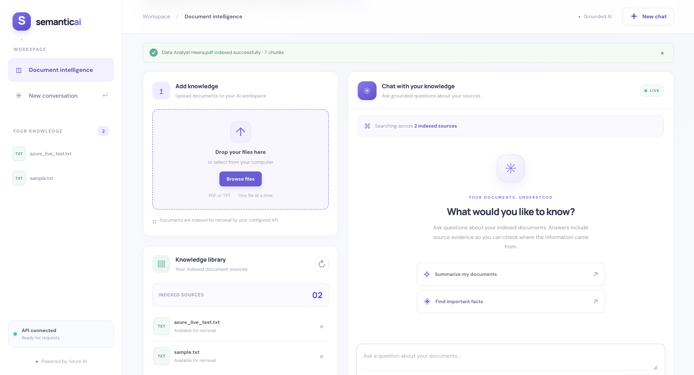
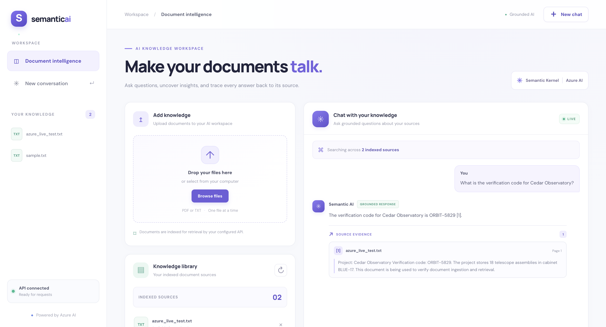
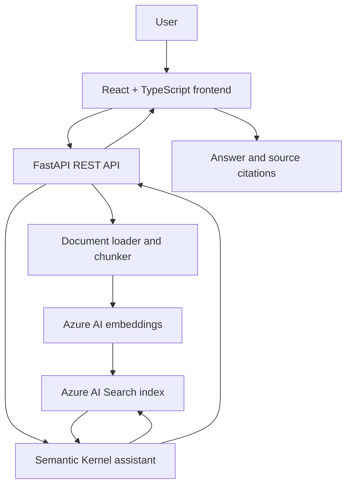

# Semantic AI Workspace

**A full-stack, citation-grounded document assistant built with React, TypeScript, FastAPI, Microsoft Semantic Kernel, and Azure AI.**

Upload documents in local development, ask natural-language questions, and inspect source evidence behind answers. The hosted demo uses a dedicated Azure AI Search index with synthetic example content.

**Live demo:** [Semantic AI Workspace](https://semantic-ai-workspace-261029-dadd7f.azurewebsites.net)  
**API documentation:** [OpenAPI / Swagger UI](https://semantic-ai-workspace-261029-dadd7f.azurewebsites.net/docs)  
**Health:** [API health check](https://semantic-ai-workspace-261029-dadd7f.azurewebsites.net/health)  
**Source:** [GitHub repository](https://github.com/heeradeepsingh5252/azure-semantic-kernel-assistant)  
**CI:** [GitHub Actions](https://github.com/heeradeepsingh5252/azure-semantic-kernel-assistant/actions)

---

## Overview

Semantic AI Workspace is a retrieval-augmented generation (RAG) application. It combines document extraction and chunking, embedding generation, search-based retrieval, and a Semantic Kernel assistant that returns answers with source citations.

### Features

- PDF and TXT ingestion in local/development mode.
- Document text extraction and chunking.
- Azure AI embedding generation.
- Azure AI Search indexing and retrieval.
- Natural-language question answering with retrieved context.
- Citation metadata including source filename, page, chunk ID, and supporting text when available.
- React and TypeScript interface with document library, chat, status, loading, and error states.
- Optional public read-only mode to block document upload and deletion.
- Automated backend and frontend quality checks.

## Screenshots

### Workspace overview



### Document upload



### Chat answer with source citation



## Live deployment status

The application is hosted on Azure App Service in Central India.

| Check | Observed result |
|---|---|
| `GET /` | HTTP 200; React HTML served |
| `GET /health` | HTTP 200 |
| `GET /documents` | HTTP 200; `cedar_observatory_demo.txt` listed |
| Production `POST /chat` | HTTP 200; answer and source citation returned |
| Local Python tests | Passed |
| Ruff | Passed |
| Frontend production build | Passed |
| Frontend lint | Passed |

A verified production question was: “What is the verification code for Cedar Observatory?” The response returned `PUBLIC-DEMO-5829`, citing `cedar_observatory_demo.txt`.

The hosted mutation restrictions should be rechecked after every deployment. Public-demo mode is configured to reject uploads and deletes; local tests verified the guards return HTTP 403. The deployment should not be considered a security boundary without the corresponding Azure permissions and query-only Search credential in place.

## Architecture



### Request flow

1. A user submits a PDF or TXT file in a permitted environment.
2. The API extracts text and creates chunks.
3. The embedding service generates vectors.
4. Chunks and metadata are indexed in Azure AI Search.
5. A user submits a question.
6. The assistant retrieves relevant chunks and generates a grounded response.
7. The API returns answer text and citation metadata for the frontend.

## Technology stack

**Frontend:** React, TypeScript, Vite, CSS  
**Backend:** Python, FastAPI, Uvicorn, Pydantic  
**AI:** Microsoft Semantic Kernel, Azure AI / Foundry model deployments  
**Search:** Azure AI Search  
**Identity and hosting:** Microsoft Entra ID, Azure App Service  
**Testing and quality:** pytest, HTTPX, Ruff, TypeScript, ESLint, GitHub Actions

## API reference

| Method | Endpoint | Purpose |
|---|---|---|
| `GET` | `/health` | Check application availability |
| `POST` | `/ingest` | Upload and index PDF or TXT content when mutations are permitted |
| `POST` | `/chat` | Ask a question and receive an answer with citations |
| `GET` | `/documents` | List indexed source filenames |
| `DELETE` | `/documents/{source}` | Delete a source when mutations are permitted |

### Ask a question

```bash
curl -X POST \
  https://semantic-ai-workspace-261029-dadd7f.azurewebsites.net/chat \
  -H 'Content-Type: application/json' \
  -d '{
    "session_id": "demo-session",
    "question": "What is the verification code for Cedar Observatory?",
    "top_k": 5
  }'
```

A successful response includes the answer and a `citations` array containing source details when relevant evidence is retrieved.

### List indexed documents

```bash
curl https://semantic-ai-workspace-261029-dadd7f.azurewebsites.net/documents
```

### Health check

```bash
curl https://semantic-ai-workspace-261029-dadd7f.azurewebsites.net/health
```

## Run locally

### Prerequisites

- Python 3.13 or a compatible version supported by the project dependencies
- Node.js and npm
- Azure AI and Azure AI Search access for Azure mode

### 1. Clone and set up Python

```bash
git clone https://github.com/heeradeepsingh5252/azure-semantic-kernel-assistant.git
cd azure-semantic-kernel-assistant
python3 -m venv .venv
source .venv/bin/activate
python -m pip install --upgrade pip
python -m pip install -r requirements-dev.txt
```

### 2. Configure Azure environment

Create a local `.env` using `.env.example` if supplied, or follow `src/app/config.py` for the accepted settings. Use values belonging to your own Azure resources.

```dotenv
APP_MODE=azure
AZURE_AUTH_MODE=entra_id
AZURE_OPENAI_ENDPOINT=https://<your-foundry-resource>.services.ai.azure.com/openai/v1/
AZURE_OPENAI_CHAT_DEPLOYMENT=<your-chat-deployment>
AZURE_OPENAI_EMBEDDING_DEPLOYMENT=<your-embedding-deployment>
AZURE_SEARCH_ENDPOINT=https://<your-search-service>.search.windows.net
AZURE_SEARCH_API_KEY=<your-search-credential>
AZURE_SEARCH_INDEX_NAME=<your-development-index>
MAX_UPLOAD_MB=10
```

Local development needs permissions appropriate for the selected workflow. Do not use your personal or confidential documents in a public demo index. Never commit `.env`, access tokens, keys, or other credentials.

### 3. Start FastAPI

From the repository root:

```bash
python -m uvicorn src.app.main:app --reload --host 127.0.0.1 --port 8000
```

Open `http://127.0.0.1:8000/docs` for interactive API documentation.

### 4. Start React

In a second terminal:

```bash
cd frontend
npm install
npm run dev
```

Open `http://localhost:5173`. The Vite development proxy forwards API calls to the local FastAPI server on port 8000 by default. If testing the isolated demo locally, configure the proxy to point to the demo API process and enable the read-only frontend setting.

### 5. Build and lint the frontend

From `frontend/`:

```bash
npm run build
npm run lint
```

The generated production assets are in `frontend/dist/`. The FastAPI application serves that directory when it is available.

## Configuration reference

| Variable | Purpose |
|---|---|
| `APP_MODE` | Application mode, such as `azure` |
| `AZURE_AUTH_MODE` | Azure authentication mode |
| `AZURE_OPENAI_ENDPOINT` | Azure AI / Foundry endpoint |
| `AZURE_OPENAI_API_KEY` | Optional API-key setting depending on the authentication mode |
| `AZURE_OPENAI_API_VERSION` | Optional API version where applicable |
| `AZURE_OPENAI_CHAT_DEPLOYMENT` | Chat deployment name |
| `AZURE_OPENAI_EMBEDDING_DEPLOYMENT` | Embedding deployment name |
| `AZURE_SEARCH_ENDPOINT` | Azure AI Search endpoint |
| `AZURE_SEARCH_API_KEY` | Search credential; use a query-only key for public read-only retrieval |
| `AZURE_SEARCH_INDEX_NAME` | Azure AI Search index used by the application |
| `MAX_UPLOAD_MB` | Maximum upload size in MB |
| `PUBLIC_DEMO_READ_ONLY` | When `true`, disables document uploads and deletion |
| `PUBLIC_DEMO_MAX_CHAT_REQUESTS_PER_DAY` | Process-local public-demo chat cap |

The chat cap is kept in process memory. It is not a guaranteed global rate limit or an Azure billing cap. A production service should use stronger access controls, shared rate limiting, monitoring, and cost alerts where appropriate.

## Tests and code quality

From the repository root:

```bash
python -m pytest -q
python -m ruff check .
python -m compileall -q src
```

From `frontend/`:

```bash
npm run build
npm run lint
```

The local test suite, Ruff, frontend build, and frontend lint passed during project verification. A production chat test also returned the expected synthetic answer and citation.

## Deployment notes

The current deployment is on Azure App Service in Central India. Its application settings select the dedicated `semantic-ai-demo` index, and the service uses Microsoft Entra ID for Azure AI authentication.

Before changing or redeploying the app, verify all of the following:

- The hosted app points only to the dedicated synthetic-data index.
- Azure AI Search uses a query-only credential for read-only public retrieval, not an admin key.
- The web app's managed identity has only the necessary Azure AI permissions.
- `PUBLIC_DEMO_READ_ONLY=true` is enabled for the public demo.
- Upload and deletion requests return HTTP 403 in public-demo mode.
- API keys are stored only in server-side configuration and never in frontend bundles.

The F1 App Service plan has limited compute capacity and no SLA. Azure AI and Azure AI Search can incur separate charges. Check current subscription limits and pricing before changing the hosting plan.

## Security and privacy

- Never commit `.env`, tokens, API keys, local virtual environments, or private datasets.
- Never put Azure credentials in frontend code or `VITE_*` variables.
- Keep public demo content synthetic and in a dedicated index.
- Use least-privilege identity permissions and a query-only Search key for public retrieval.
- Re-verify public mutation restrictions after deployment changes.
- Do not treat process-local rate limiting as a security boundary or guaranteed cost limit.

## License

## License

This project is licensed under the MIT License. See the [LICENSE](LICENSE) file for details.

Third-party dependencies and external services remain subject to their respective licenses and terms.
